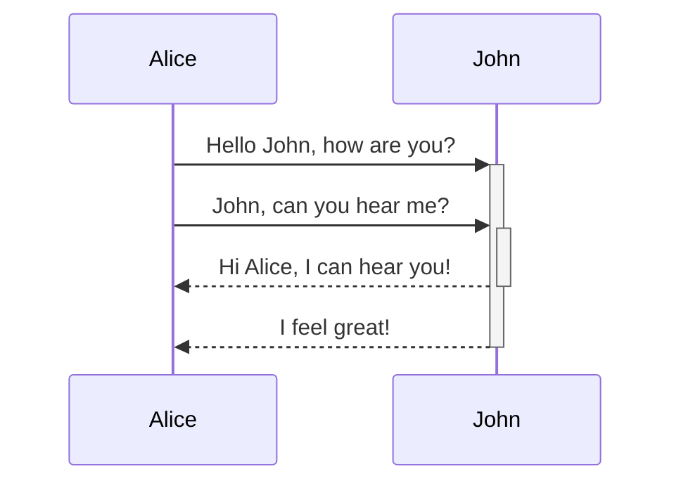
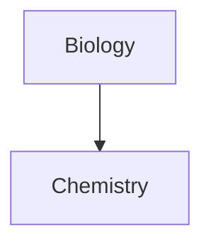

# Obsidian 高度な書式構文

出典: <https://obsidian.md/help/advanced-syntax>

## 表

縦棒（`|`）で列を区切り、ハイフン（`-`）でヘッダーを定義する。両側の縦棒は任意だが読みやすさのため推奨。

```md
| First name | Last name |
| ---------- | --------- |
| Max        | Planck    |
| Marie      | Curie     |
```

ヘッダー行には**少なくとも2つのハイフン**が必要。セルの長さは揃っていなくてもよい：

```md
First name | Last name
-- | --
Max | Planck
Marie | Curie
```

### 表内の書式

基本的な書式構文を表内で使用できる。ウィキリンクのエイリアスや画像のサイズ指定で **縦棒の前に `\` を追加** する必要がある。

```md
First column | Second column
-- | --
[[基本的な書式構文\|Markdown構文]] | ![[Engelbart.jpg\|200]]
```

### アラインメント

ヘッダー行のハイフンに `:` を加える：

| 書き方 | 意味 |
|---|---|
| `:--` | 左寄せ |
| `:--:` | 中央 |
| `--:` | 右寄せ |

```md
Left-aligned | Center-aligned | Right-aligned
:-- | :--: | --:
Content | Content | Content
```

ライブプレビューではコンテキストメニューからもアラインメントを変更できる。

## ダイアグラム（Mermaid）

[Mermaid](https://mermaid-js.github.io/) を `mermaid` コードブロックで使用する。

サポートされているダイアグラム種類（[Mermaid公式](https://mermaid.js.org/intro/)）：

- フローチャート
- シーケンス図
- クラス図
- ステート図
- ER図
- ガントチャート
- パイチャート
- タイムライン
- マインドマップ
- ユーザージャーニー
- C4図
- Gitグラフ
- 象限チャート
- サンキー図

### シーケンス図

````md

````

### フローチャート

````md

````

`graph TD` は上から下、`graph LR` は左から右など。

### ダイアグラム内で内部リンクを作成

ノードに `internal-link` クラスを付与する。

````md

````

多数のノードがある場合、全文字を一括で内部リンク化できる：

````md

````

ノード名に特殊文字を含む場合はダブルクォートで囲む：

```
class "⨳ special character" internal-link
```

または：

```
A["⨳ special character"]
```

> 注意: ダイアグラムからの内部リンクは**グラフビューには表示されない**。

> ヒント: ノートに含める前に [Mermaid Live Editor](https://mermaid-js.github.io/mermaid-live-editor) でプレビューできる。

## 数学（MathJax / LaTeX）

[MathJax](http://docs.mathjax.org/en/latest/basic/mathjax.html) と LaTeX 記法をサポート。

### ブロック数式

ダブルドル記号 `$$` で囲む：

```md
$$
\begin{vmatrix}a & b\\
c & d
\end{vmatrix}=ad-bc
$$
```

### インライン数式

シングルドル `$` で囲む：

```md
これはインライン数式 $e^{2i\pi} = 1$ です。
```

### リファレンス

- [MathJax 基本チュートリアル](https://math.meta.stackexchange.com/questions/5020/mathjax-basic-tutorial-and-quick-reference)
- [TeX/LaTeX 拡張機能リスト](http://docs.mathjax.org/en/latest/input/tex/extensions/index.html)
